I'm a senior iOS engineer in Pune. I build and ship Swift apps and the packages underneath them, and I publish the reusable parts here.

## Expertise

## How I work

- **Small packages, clear edges.** Features live in their own Swift packages with a deliberately small public API, so other code can depend on them without knowing how they work inside.
- **Break cycles early.** When two packages need to talk but can't import each other, I put a thin shared-events package between them and let NotificationCenter carry the messages.
- **Automate the release path.** Fastlane lanes and TestFlight rounds instead of hand-archiving, so shipping is repeatable.
- **Give every iOS release a compatibility pass.** iOS 26's Liquid Glass reshaped the tab and navigation bars; I override appearance explicitly rather than trusting defaults.
- **Treat security as part of the feature.** Encryption and token handling get reviewed alongside the code, not after it.
- **Learn sideways.** React and .NET backend work, picked up alongside iOS.

## Open source

### Swift packages & SDKs

| Package | What it does | Tech |
|---|---|---|
| [**IOS_APIManager**](https://github.com/Hkashif722/IOS_APIManager) | Lightweight networking package manager for iOS apps — clean, type-safe API layer over URLSession | Swift · SPM |
| [**GamificationPackage**](https://github.com/Hkashif722/GamificationPackage) | SDK for embedding gamification mechanics (badges, streaks, leaderboards) into iOS apps | Swift · SPM |
| [**AssessmenyKitPackage**](https://github.com/Hkashif722/AssessmenyKitPackage) | Assessment and quiz kit for iOS — modular, embeddable evaluation flows | Swift · SwiftUI · SPM |
| [**AcuityIQPackage**](https://github.com/Hkashif722/AcuityIQPackage) | Cognitive assessment package with IQ-style evaluation components | Swift · SwiftUI · SPM |

### UI utilities

| Library | What it does | Tech |
|---|---|---|
| [**SwiftUIUtility**](https://github.com/Hkashif722/SwiftUIUtility) | Collection of reusable SwiftUI components and view modifiers | Swift · SwiftUI |
| [**HKPopupManager**](https://github.com/Hkashif722/HKPopupManager) | Flexible popup presentation manager — supports custom animations and dismissal styles | Swift · UIKit |
| [**PopoverUtility**](https://github.com/Hkashif722/PopoverUtility) | Streamlined popover utility with configurable anchoring and layout | Swift · SwiftUI |

### Apps & experiments

| Project | What it does | Tech |
|---|---|---|
| [**AIChatCourse**](https://github.com/Hkashif722/AIChatCourse) | Native iOS AI chat app exploring LLM integration patterns | Swift · SwiftUI |
| [**DownloadManager**](https://github.com/Hkashif722/DownloadManager) | Background download manager with progress tracking and retry logic | Swift · URLSession |
| [**Web_SSO**](https://github.com/Hkashif722/Web_SSO) | Web-based Single Sign-On integration for iOS apps | Swift · WebKit |
| [**Experimental**](https://github.com/Hkashif722/Experimental) | R&D sandbox — where new iOS ideas get prototyped and tested | Swift |

---

Open to collaborations on iOS tooling and SDK projects. Find me on [LinkedIn](https://www.linkedin.com/in/kashif-hussain-ba5b0a197).
